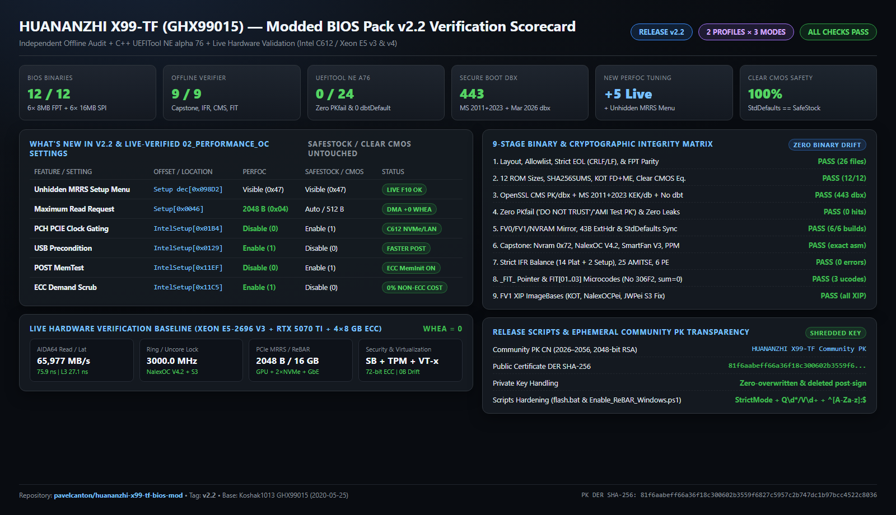
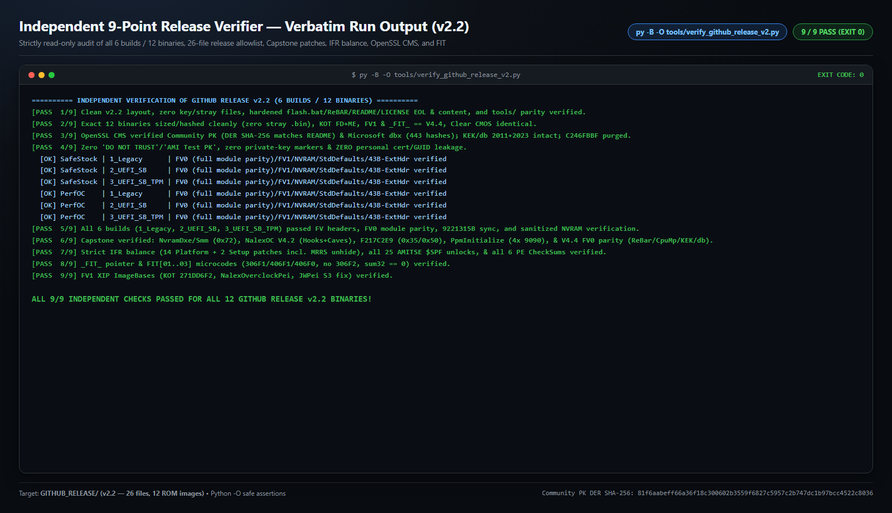
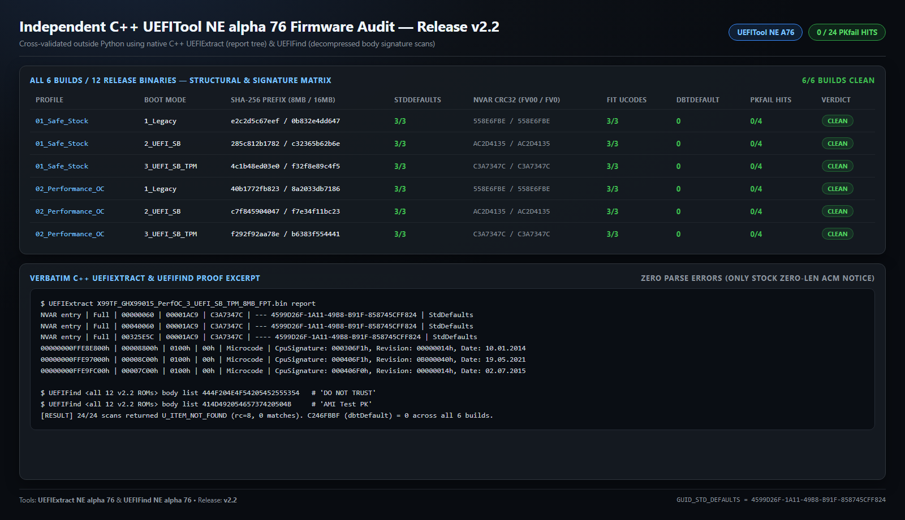

# Huananzhi X99-TF — модифицированный BIOS v2.2 (GHX99015, 25.05.2020)

**🇷🇺 Русский** | [🇬🇧 English](README.en.md)

Пакет готовых прошивок **v2.2** для **HUANANZHI X99-TF** на базе сборки [Koshak1013](https://github.com/Koshak1013/HuananzhiX99_BIOS_mods) (`GHX99015`, 25.05.2020): анлок Turbo Boost для Xeon E5 v3, **живой андервольт и лок Ring/Uncore прямо в меню BIOS с реальным сохранением по `F10`**, 25 разблокированных подменю + открытый **`Maximum Read Request`**, оптимизации `02_Performance_OC` из живой обкатки **`V4.6`** (`MRRS = 2048 B`, `PCH PCIE Clock Gating = Disable`, `USB Precondition = Enable`, `MemTest = Disable`, безопасный `ECC Demand Scrub = Enable`), расшитые лимиты питания, ReBAR, чистый Secure Boot **2011 + 2023 без уязвимости `PKfail` + 443 отзыва `dbx`**, TPM 2.0, работающий `Intel VT-x` и исправленный SmartFan V3 (с поддержкой S3-сна).

Вместо 4 жёстких тиров андервольта из v1.1 теперь достаточно **2 профилей × 3 режима = 6 сборок** — все параметры разгона, MRRS и тайминги ОЗУ можно настраивать в моменте в BIOS Setup, а сброс CMOS гарантированно возвращает безопасный `Safe Stock`.

> [!TIP]
> **Скачать всё одним архивом:** [страница Releases](../../releases/latest) → файл `X99TF_GHX99015_BIOS_Pack_v2.2.zip`. Или берите отдельные файлы прямо из папок ниже.

> [!CAUTION]
> **Только для HUANANZHI X99-TF (`GHX99014` / `GHX99015`).** Не шейте на другие платы X99 (Machinist, Kllisre, Qiyida, Jingsha, другие модели Huananzhi и т.д.): у них другие Flash Descriptor, разводка памяти, Super I/O, GPIO и линии PCIe — высокий риск «кирпича» с восстановлением только программатором.
>
> **Лимиты питания расшиты: `PL1 = 200 W`, `PL2 = 250 W`, `Tau = 56 s`.** На 10–18-ядерных Xeon под долгой нагрузкой это сильно греет VRM платы. Обеспечьте обдув VRM или снизьте лимиты прямо в BIOS (см. [Гайд по тюнингу в BIOS](#гайд-по-разгону-и-тюнингу-в-bios)).

---

## Что нового в v2.2 (и история v2.0 / v2.1 / v2.1.2)

> [!IMPORTANT]
> **Релиз v2.2 — проверенные на живом железе оптимизации PCIe/C612/POST + открытое меню `Maximum Read Request`:**
> * **Открыт пункт `Maximum Read Request` в BIOS Setup** (`Advanced → PCI Subsystem Settings → PCI Express Settings`): позволяет менять PCIe MRRS (`Auto` / `512 B` / `2048 B` и т.д.) прямо в меню BIOS с сохранением по `F10`.
> * **5 новых проверенных оптимизаций в профиле `02_Performance_OC`** (`01_Safe_Stock` и фабричные `StdDefaults` для Clear CMOS сохраняют консервативные настройки):
>   1. **`Maximum Read Request = 2048 B`** (`Setup[0x0046] = 0x04`; в `Safe Stock` / Clear CMOS = `Auto / 512 B`) — ускоряет крупные DMA-чтения на GPU (RTX 5070 Ti), NVMe и GbE без единого события WHEA.
>   2. **`PCH PCIE Clock Gating = Disable`** (`IntelSetup[0x01B4] = 0`) — убирает задержку пробуждения тактирования линий PCIe чипсета C612 (PCH M.2 NVMe и сетевой контроллер).
>   3. **`USB Precondition = Enable`** (`IntelSetup[0x0129] = 1`) — ускоряет инициализацию xHCI USB 3.0 на старте POST.
>   4. **`MemTest = Disable`** (`IntelSetup[0x11EF] = 0`) — ускоряет холодный старт POST, **полностью сохраняя** полноценную инициализацию памяти `MemInit` и 72-бит ECC (`MRC Fast Boot` остаётся выключен).
>   5. **`Demand Scrub = Enable`** (`IntelSetup[0x11C5] = 1`, при выключенном `Patrol Scrub = 0`) — в `UncoreInitPeim` аппаратно маскируется флагом наличия ECC: **0% нагрузки на обычной не-ECC ОЗУ** и защита от накопления однобитных ошибок на ECC RDIMM без фонового трафика памяти.
> * **Усиленные скрипты:** `flash.bat` обновлён до `v2.2` (усилены SMBIOS-фильтр `Q\d*`/`V\d+` и проверка буквы системного диска для BitLocker); в `Enable_ReBAR_Windows.ps1` добавлен `Set-StrictMode -Version Latest` и убран пустой `catch`.
> * **Новый одноразовый Community PK для v2.2:** 2048-бит RSA `HUANANZHI X99-TF Community Platform Key`, приватный ключ перезаписан нулями и уничтожен сразу после подписи (см. SHA-256 ниже).
>
> **Обслуживающий релиз v2.1.2 (все 12 образов BIOS байт-в-байт идентичны `v2.1` и `v2.1.1`):**
> * **`Enable_ReBAR_Windows.bat` (безопасность):** полностью убраны инъекции аргументов (`set "_ARG1=%~1"` и проброс сырого `%*`); лаунчер безопасно читает аргументы и передаёт в PowerShell только строго разрешённый список (`-Action Enable|Disable|Status`), корректно завершаясь без `pause` при любых CLI-аргументах.
> * **`Enable_ReBAR_Windows.ps1`:** при неожиданной ошибке чтения UEFI-переменной `ReBarState` (кроме кодов `122`/`203`) скрипт немедленно завершается (`exit 1`) без попытки записи в NVRAM.
> * **`flash.bat`:** исправлена регулярка проверки `SHA256SUMS.txt` под `call` (`\A...\z` без символа `^`), усилена проверка SMBIOS-имени платы и синхронизирована финальная подсказка про 10-секундный холодный старт.
> * **Документация (`README.md` + `README.en.md`):** исправлены точный путь `UFS` (`IntelRCSetup → Advanced Power Management Configuration`), описание `MC0/MC1 PKGC CLK GATE DISABLE` (`значение 1 = Disable в BIOS`), упоминание `SATA/sSATA AHCI ALPM` и `LPM`, точные названия пунктов IFR (`CPU - Advanced PM Tuning`, `CPU VCCin Voltage Level`, `VccIo Voltage Control`, `VCCU Voltage Offset`), уточнение по `MokManager` (для загрузчиков на базе `shim`) и вынесена полноценная английская версия в [`README.en.md`](README.en.md).
>
> **Обслуживающий релиз v2.1.1 (все 12 образов BIOS байт-в-байт идентичны `v2.1`):**
> * **`Enable_ReBAR_Windows.ps1` / `.bat`:** строгая проверка 1-байтного контракта `ReBarDxe` (`DataSize = 1`; переменные `>1 B` помечаются `[WARN]` как неактивные), корректный вывод инструкций (без подсказки Enable при `-Action Disable`), точная 2-перезагрузочная инструкция Legacy → UEFI, обработка `FirmwareType = Unknown` и `try/catch` вокруг `EnablePrivilege()`; в `.bat` добавлены `DisableDelayedExpansion` и поддержка CLI-аргументов.
> * **`flash.bat`:** защищён `chcp.com 65001 <nul >nul`, убран двойной слэш `Z:\\` в корне дисков, разделены сообщения об ошибках SHA-256 (`BAD` / `MISSING` / `ERR`), убрано некорректное упоминание включения CSM при активном Secure Boot.
> * **`README.md`:** исправлен совет по восстановлению при активном Secure Boot (`CsmDxe` блокирует CSM), уточнена 2-этапная последовательность перехода с `1_Legacy` на UEFI+ReBAR, перечислены все 10 предзаполненных таймингов Micron и добавлены примечания по особенностям платформы.
>
> **Исправления v2.1 (обязательно к обновлению с v2.0):**
> * Исправлен `GUID_STD_DEFAULTS` (`4599D26F-...`) в таблице NVRAM: в `v2.0` при первом старте `02_Performance_OC` срабатывал Bank Swap со сбросом 23 настроек в `01_Safe_Stock` — теперь **`02_Performance_OC` (`−50/−40 mV`, лок Ring, C-States OFF, IMC) гарантированно применяется с первого холодного старта**!
> * Возвращён `MSR Lock Control = Enable` (`0x0075 = 1`): исправлен **аппаратный `Intel VT-x`** (в `v2.0` виртуализация отключалась в Диспетчере задач) и восстановлен `MSR 0xE2` CFG Lock.
> * В `flash.bat` используются короткие относительные пути — устранён `Error 200` Intel FPT на длинных путях (>127 символов) и папках с кириллицей/пробелами.

| Область | Что сделано и проверено на живом железе |
| :--- | :--- |
| **Реальное сохранение настроек (`F10`)** | Исправлен критический баг `NvramDxe` / `NvramSmm` (`0x70 → 0x72`, проверка размера 114-байтной структуры `Setup`). Ранее при каждом ребуте срабатывал `ResetToDefaults + BankSwap`, сносивший правки из BIOS. Теперь любые настройки сохраняются постоянно. |
| **Живой андервольт и лок Ring (`NalexOverclock V4.2`)** | Вместо вшитого `ser8989_S3TurboHack` используется доработанный `NalexOverclock` (DXE + PEI): анлок Turbo Boost + настройка Core/CLR/SA оффсетов и **аппаратный лок Ring/Uncore (`MSR 0x620` пишется строго после `MSR 0x150`, плюс запись в S3 BootScript)** без просадок до 1200 МГц и после выхода из сна. На Xeon v3 параметр `CLR Max OC Ratio = 30` автоматически ограничивается заводским потолком конкретного CPU; на Xeon v4 модуль безопасно пропускается. |
| **Secure Boot без `PKfail` (CVE-2024-8105) + `dbx` 2026** | Скомпрометированный `DO NOT TRUST - AMI Test PK` полностью вычищен (из `PK`, `PKDefault` и дубликата `dbtDefault`). Вшит чистый 2048-бит RSA **`HUANANZHI X99-TF Community Platform Key`** (`2026–2056`, **приватный ключ безвозвратно уничтожен сразу после подписи**), актуальные сертификаты Microsoft **2011 + 2023** (`KEK`/`db`), официальная база отзывов Microsoft **`dbx` от марта 2026 (443 SHA-256 хэша)** и нативные 43-байтные AMI ExtHeaders. |
| **SmartFan V3 + S3 Fix (`F217C2E9`)** | Устранён скрытый баг принудительных **100% оборотов при 70°C**: патч `F217C2E9` исправляет запись `T5` (`78°C`) в регистр `CRITICAL_TEMP` (`0x35`) вместо `0x3A` и сохраняет кривую вентилятора (`60→20%`, `66→40%`, `72→60%`, `75→80%`, `78→100%`) после сна S3. |
| **25 открытых меню и фиксы платформы** | `Power Technology = Custom` по умолчанию (открыты `CPU P/C/T State` и `C1E`, убрана ловушка сброса `PwrMgtCustConfig`); `Pkg Clmp Lim1/2 = Between P1/P0` (нет просадок до 1200 МГц под RAPL); исправлены указатели `_FIT_` на микрокоды (`306F1`/`406F1 rev B000040`/`406F0`, без `306F2`); включён датчик температуры чипсета C612 (`PCH Thermal`); `Timeout = 3s`; `XHCI Idle L1 = Disabled`; `PCIe Relaxed Ordering / Extended Tag = Enabled`; `DMI/PCIe ASPM = Disabled`; `ACPI T-States = Disabled`. |
| **Безопасный Clear CMOS откат** | В **обеих** ветках (`01_Safe_Stock` и `02_Performance_OC`) фабричные `StdDefaults` 100% идентичны ультра-стабильному `01_Safe_Stock` (`0/0 mV`, динамический Ring, C-States ON, ОЗУ в Auto, все ядра). Любой переразгон сбрасывается перемычкой `JCMOS` без программатора. |

---

## Какую сборку выбрать

Структура: **`<профиль>/<режим>/`**, в каждой папке два файла:
* `*_8MB_FPT.bin` — для прошивки из Windows через `flash.bat`;
* `*_16MB_CH341A.bin` — полный образ для программатора (чистый стоковый Flash Descriptor + Intel ME `9.1.37.1002` + BIOS).

### 1. Стартовый профиль

| Папка | Что активно сразу после прошивки | Для кого |
| :--- | :--- | :--- |
| **`01_Safe_Stock`** | Анлок Turbo Boost, `0 / 0 mV`, динамический Ring (`CLR = 0`), **`C1E / C2 / C3 = ON, C6 = OFF`**, контроллер памяти и ОЗУ в `Auto`, все ядра активны | Максимальная стабильность «из коробки», **лучший выбор для Xeon E5 v4** или если хотите крутить всё вручную с нуля |
| **`02_Performance_OC`** | Анлок Turbo Boost, универсальный безопасный андервольт **`−50 mV Core / −40 mV Ring`**, **лок Ring на максимум CPU** (`CLR = 30`, авто-ограничение под модель v3), C-States OFF (`C0/C1`, `C1E/C3/C6` выкл.), **`MRRS = 2048 B`**, **`PCH PCIE Clock Gating = Disable`**, **`USB Precondition = Enable`**, **`MemTest = Disable`** (с сохранением ECC `MemInit`), безопасный тюнинг IMC (`Early Snoop`, `Open Page`, `Turnaround Opt`, `CKE/OppSR/MDLL Off/Set Throttling Mode/Patrol Scrub/SATA+sSATA AHCI ALPM/LPM` выкл., **`Demand Scrub = Enable`**, `MC0/MC1 PKGC CLK GATE DISABLE`), **ОЗУ и `tREFI` в `Auto`**, все ядра активны | **Рекомендуется для большинства Xeon E5 v3.** Мгновенный прирост отзывчивости, быстрый POST и снижение задержек на любой памяти DDR4; сброс CMOS всегда вернёт `Safe Stock` |

> [!NOTE]
> Оба профиля собраны на **идентичном** коде BIOS (`FV0` / `FV1` / `StdDefaults` совпадают байт-в-байт). В любой момент вы можете перенастроить андервольт, Ring, ядра, C-States или тайминги ОЗУ прямо в BIOS Setup без перепрошивки.

### 2. Режим загрузки

| Подпапка | Загрузка | Above 4G / ReBAR | Secure Boot (2011+2023) | TPM 2.0 | Для чего |
| :--- | :---: | :---: | :---: | :---: | :--- |
| `1_Legacy` | CSM вкл. | выкл. | выкл. | выкл. | Windows на MBR, старые видеокарты без UEFI GOP |
| `2_UEFI_SB` | чистый UEFI | вкл. | вкл. | выкл. | Windows 10/11 на GPT, без модуля TPM |
| `3_UEFI_SB_TPM` | чистый UEFI | вкл. | вкл. | вкл. | Windows 11 с аппаратным TPM 2.0, античиты (Vanguard, FACEIT) |

> [!IMPORTANT]
> Пунктов Secure Boot и TPM в меню этого BIOS **нет** — нужный режим выбирается при прошивке.

---

## Как прошить

### Из Windows — `flash.bat` (рекомендуется)
1. Запустите **`flash.bat`** от имени администратора, выберите профиль (`1–2`) и режим (`1–3`).
2. Скрипт снимет бэкап: сначала пробует полный 16 МБ дамп, если плата не даёт — 8 МБ регион BIOS. Файл `backup_*.bin` появится рядом со скриптом.
3. **Скопируйте бэкап в облако / на флешку / на другой ПК**, затем введите `YES`.
4. Скрипт прошьёт **только 8 МБ регион BIOS** (Flash Descriptor и Intel ME вашей платы не трогаются) и выполнит полную верификацию.
5. Сделайте **полное выключение ПК на 10 секунд → включение** (холодный старт). Первая тренировка памяти займёт ~15–30 секунд.

### Программатором CH341A
Записывайте `*_16MB_CH341A.bin` на всю микросхему (`W25Q128` / `MX25L128`), предварительно сняв с неё полный 16 МБ дамп. **Не шейте 16 МБ файл из Windows.**

---

## После прошивки

### 1. Анлок Turbo Boost на Xeon E5 v3 (отключение микрокода в Windows)
Если оставить штатный файл, Windows сама загрузит микрокод `306F2` и анлок пропадёт. Выполните от администратора:

**PowerShell (администратор):**
```powershell
takeown /f "C:\Windows\System32\mcupdate_GenuineIntel.dll"
icacls "C:\Windows\System32\mcupdate_GenuineIntel.dll" /grant "*S-1-5-32-544:F"
Rename-Item "C:\Windows\System32\mcupdate_GenuineIntel.dll" "mcupdate_GenuineIntel.dll.bak"
```

**Или `cmd` (администратор):**
```bat
takeown /f C:\Windows\System32\mcupdate_GenuineIntel.dll
icacls C:\Windows\System32\mcupdate_GenuineIntel.dll /grant *S-1-5-32-544:F
ren C:\Windows\System32\mcupdate_GenuineIntel.dll mcupdate_GenuineIntel.dll.bak
```

Перезагрузитесь. Крупные обновления Windows могут вернуть файл — тогда повторите. В Linux не загружайте `intel-ucode` (или добавьте `dis_ucode_ldr`).
* **Проверка анлока:** откройте **HWiNFO64** или **CPU-Z** (*Bench → Stress CPU*) — частота под нагрузкой на все ядра должна выходить на максимальный all-core Turbo Boost (до упора в `PL1`/`PL2`), а в `02_Performance_OC` вкладка `Memory → LLC/Ring` должна держаться ровно на максимальной частоте Ring без падений до `1200 МГц`.
* **Заметка про WSL2 / античиты с микрокодом `0x00`:** в BIOS включены `VT-x`, `VT-d`, `DMAR`. При использовании микрокода `0x00` держите в Windows выключенной «Целостность памяти» (VBS / HVCI); если нужны и FACEIT/Vanguard, и WSL2/Docker — удобно сделать два пункта загрузки через `bcdedit` (`hypervisorlaunchtype off` / `auto`).

### 2. Переход с MBR на GPT (если нужен UEFI-режим)
С `2_UEFI_SB`/`3_UEFI_SB_TPM` плата не загрузит MBR-диск. Узнайте номер системного диска `N` и стиль разделов (`MBR` или `GPT`) в PowerShell:
```powershell
Get-Partition -DriveLetter C | Get-Disk
```
Сохраните важные файлы и сконвертируйте диск из `cmd` / PowerShell **от администратора** (подставьте ваш номер вместо `0`):
```bat
mbr2gpt /validate /disk:0 /allowFullOS
mbr2gpt /convert /disk:0 /allowFullOS
```
Если не хотите конвертировать — шейте `1_Legacy`.

### 3. Resizable BAR (ReBAR)
В `2_UEFI_SB` и `3_UEFI_SB_TPM` ReBAR уже включён (`ReBarState = 0x20`). На видеокартах без поддержки ReBAR (GTX 10/16, RTX 20) драйвер `ReBarDxe` просто пропускает карту. Если вы прошили `1_Legacy`, а позже перешли на GPT/UEFI, нужна **обязательная 2-этапная перенастройка BIOS с двумя перезагрузками** (т.к. отключение `CSM Support` скрывает пункт `Video`):
1. В BIOS откройте `Advanced → CSM Configuration → Video = UEFI` → нажмите `F10` и **перезагрузитесь**.
2. Снова войдите в BIOS: `Advanced → CSM Configuration → CSM Support = Disabled` и `Advanced → PCI Subsystem Settings → Above 4G Decoding = Enabled` → нажмите `F10` и загрузите UEFI Windows.
3. Запустите **`Enable_ReBAR_Windows.bat`** от имени администратора и перезагрузите ПК (также поддерживаются CLI-аргументы, например `Enable_ReBAR_Windows.bat -Action Status`).
* **Проверка:** **GPU-Z** → `Resizable BAR: Enabled` (или *Панель управления NVIDIA → Информация о системе → Изменяемый размер BAR: Да*).

### 4. Проверка Secure Boot (2011 + 2023, отсутствие `PKfail`, 443 отзыва `dbx`)
Запустите в PowerShell **от администратора** (для `2_UEFI_SB` и `3_UEFI_SB_TPM`):
```powershell
Confirm-SecureBootUEFI
$pk  = [System.Text.Encoding]::ASCII.GetString((Get-SecureBootUEFI -Name PK).Bytes)
$kek = [System.Text.Encoding]::ASCII.GetString((Get-SecureBootUEFI -Name KEK).Bytes)
$db  = [System.Text.Encoding]::ASCII.GetString((Get-SecureBootUEFI -Name db).Bytes)
[PSCustomObject]@{
  Community_PK   = ($pk -match 'HUANANZHI X99-TF Community Platform Key')
  AMI_Test_PK    = ($pk -match 'DO NOT TRUST|AMI Test PK')   # должно быть False!
  KEK_2023       = ($kek -match 'KEK 2K CA 2023')
  Win_UEFI_2023  = ($db -match 'Windows UEFI CA 2023')
  MS_UEFI_2023   = ($db -match 'Microsoft UEFI CA 2023')
  OptROM_2023    = ($db -match 'Option ROM UEFI CA 2023')
  DBX_Bytes      = (Get-SecureBootUEFI -Name dbx).Bytes.Length  # 21292 (443 SHA-256)
}
```
Ожидаемый результат: `Confirm-SecureBootUEFI = True`, `AMI_Test_PK = False`, все флаги `*_2023 = True`, `Community_PK = True`, `DBX_Bytes = 21292`.

---

## Гайд по разгону и тюнингу в BIOS

В **v2.1+** все ключевые меню открыты, `Power Technology = Custom` уже безопасно активирован, а правки сохраняются по `F10`. Нажмите **`Del`** при старте (задержка `Timeout = 3 сек`).

### Карта основных параметров для повышения производительности

| Параметр | Путь в меню BIOS | Безопасный тюнинг / рекомендация |
| :--- | :--- | :--- |
| **Андервольт CPU (Core)** *(v3)* | `IntelRCSetup → OverClocking Feature → Processor` | `Offset Prefix = -`, начните с `Core Voltage Offset = 50` (`−50 мВ`). Удачные кристаллы берут `60–75 мВ` (шаг по `5–10 мВ` + тест в OCCT/Prime95/играх). Снижает нагрев VRM и поднимает частоты буста. |
| **Лок и андервольт Ring / Uncore** *(v3)* | `IntelRCSetup → OverClocking Feature → CLR/Ring` | **`CLR Max OC Ratio`**: `30` = аппаратный лок Ring на максимум вашего CPU (в `02_Performance_OC` уже стоит; авто-ограничивается потолком модели, например `27x` на 2678 v3, `30x` на 2696 v3), `0` = динамика `12x..Max`. **`Offset Prefix = -`**, **`CLR Voltage Offset = 40`** (`−40 мВ`; удачные держат `−45..−55 мВ`). Даёт резкое снижение задержек L3/ОЗУ! |
| **Ограничение ядер** *(опционально)* | `IntelRCSetup → Processor Configuration → Per-Socket Configuration → CPU Socket 0 Configuration → Cores Enabled` | `0` = все ядра. На 14–18-ядерных Xeon для игр можно выставить `10–12` ядер: ниже нагрев CPU/VRM и выше/стабильнее частота Turbo Boost (в тяжёлом рендере 100% потоков производительность пропорционально снизится). |
| **Лимиты мощности PL1 / PL2 / Tau** | `IntelRCSetup → Advanced Power Management Configuration → SOCKET RAPL Config` | По умолчанию `200 W / 250 W / 56 s`, `Pkg Clmp Lim1/2 = Between P1/P0`. Если VRM греется — снизьте `Long Dur Pwr Limit` (`PL1`) до `130–160 W`. Также `Turbo Pwr Limit Lock = Disable` (можно менять из Windows в ThrottleStop). |
| **C-States / задержка пробуждения** | `IntelRCSetup → Advanced Power Management Configuration → CPU C State Control` | Для минимальных задержек и стабильного андервольта: `Package C State limit = C0/C1`, `C3 = Disable`, `C6 = Disable`, **`Enhanced Halt State (C1E) = Disable`** (в `02_Performance_OC` уже настроено). Варианты `Package C State limit`: `C0/C1`, `C2`, `C6(non Retention)`, `C6(Retention)` (пункта `Auto` нет; в `01_Safe_Stock` заданы `C2`, `C1E/C3 = Enable`, `C6 = Disable`). |
| **Режим снупинга (L3 / IMC)** | `IntelRCSetup → QPI Configuration → QPI General Configuration` | `COD Enable = Disable`, **`Early Snoop = Enable`** (ускоряет доступ к памяти на многоядерных Xeon; в `02_Performance_OC` уже включено). |
| **Частота, тайминги и `tREFI` ОЗУ** | `IntelRCSetup → Memory Configuration → Memory Frequency` и `Memory Timings & Voltage Override` | Потолок DDR4 на Xeon E5 v3 — **2133 МГц** (`2133` или `Auto`; на Xeon E5 v4 поддерживается до **2400 МГц**). Для ручной настройки поставьте `DIMM profile = MANUAL`: откроются тайминги, `Command Timing` (`1N`/`2N`), `Memory Voltage` *(NO-OP на X99-TF, см. ниже)* и **`Refresh Rate`** (`tREFI`). Увеличение `Refresh Rate` до **`32760`** (при хорошем обдуве модулей) заметно снижает задержку ОЗУ. **Внимание:** в `MANUAL` предзаполнены все 10 жёстких таймингов под чипы **Micron** (`tCL=12, tRP=12, tRCD=12, tRAS=28, tWR=12, tRFC=200, tRRD=4, tRTP=6, tFAW=16, tCWL=11`) — на планках Hynix / обычной DDR4 выставите ненужные в `0` (`Auto`) или ослабьте до сохранения `F10` и проверяйте в TestMem5! |
| **Ускорение контроллера памяти (IMC)** | `IntelRCSetup → Memory Configuration` | `Page Policy → Page Policy = Open`; `Memory Training → Turnaround Time Optimization = Enable`; `Memory Thermal` → **`Set Throttling Mode = Disabled`**, **`MDLL Off = Disabled`**, `Memory Power Savings Mode = User Defined` → **`Memory Power Savings Advanced Options`** (`CKE Throttling = Off`, `Opportunistic SR = Disabled`); `Memory RAS Configuration` → `Patrol Scrub = Disable`, **`Demand Scrub = Enable`** (в `02_Performance_OC`; аппаратно маскируется флагом ECC — `0%` нагрузки на не-ECC ОЗУ). Также в `02_Performance_OC` отключены **`SATA/sSATA AHCI ALPM`** и **`LPM`**, и задан **`MC0/MC1 PKGC CLK GATE DISABLE`** (`значение 1 = Disable в BIOS`, путь `CPU - Advanced PM Tuning → Program CSR_SAPMCTL`). |
| **PCIe / Above 4G / MRRS** | `Advanced → PCI Subsystem Settings` | `Above 4G Decoding` (`Enabled` для UEFI/ReBAR), `PCI Express Settings`: `Relaxed Ordering = Enabled`, `Extended Tag = Enabled`, **`Maximum Read Request`** (`2048 Bytes` в `02_Performance_OC`, `Auto` в `01_Safe_Stock` — в v2.2 открыт для ручной правки!). |
| **Защита от перегрева (PROCHOT#)** | `IntelRCSetup → Advanced Power Management Configuration → CPU Thermal Management` | Держите `Bi-directional PROCHOT# = Bidirectional (normal input response)` (защита VRM). |
| **Кривая вентилятора CPU** | `Advanced → Hardware Monitor` | Точки `T1–T5`, `PWM1–PWM4`. В v2.1+ `T5` (`78°C`) корректно задаёт порог 100% оборотов и переживает сон S3. |

> [!TIP]
> **Пошаговый план тюнинга после прошивки `02_Performance_OC`:**
> 1. Загрузитесь и проверьте стабильность базовых `−50 / −40 мВ` + лока Ring (10–15 мин OCCT / игры).
> 2. По желанию аккуратно подберите андервольт глубже (например `−60 / −45 мВ` или `−65 / −45 мВ`) — если поймали BSOD, ослабьте на `5–10 мВ`.
> 3. Займитесь памятью: сначала при желании задайте `Memory Frequency = 2133`, затем переключите `DIMM profile = MANUAL` — **сразу проверьте все 10 предзаполненных жёстких таймингов Micron (`tCL=12, tRP=12, tRCD=12, tRAS=28, tWR=12, tRFC=200, tRRD=4, tRTP=6, tFAW=16, tCWL=11`) и на планках Hynix / обычной DDR4 обнулите ненужные в `0` (`Auto`) или ослабьте их (например `14-14-14-32`, `tRFC=260`) ДО сохранения `F10`!** Внутри открывшегося режима `MANUAL` выставьте **`Refresh Rate`** (`tREFI`) = `32760`, подберите тайминги и проверьте стабильность в **TestMem5 (Anta777)**.
> 4. Если после правки таймингов/вольтажа ПК не стартует — **не паникуйте**: обесточьте ПК и замкните `JCMOS` на 10 секунд, BIOS чисто откатится на `01_Safe_Stock`!

> [!WARNING]
> **Что НЕ рекомендуется менять без понимания:**
> * **`UFS`** (`IntelRCSetup → Advanced Power Management Configuration`, варианты: `0 = Enabled`, `1 = Disabled`) — оставьте **`Enabled`** (`0`). Его отключение на Haswell-EP ломает работу `MSR 0x620` и заметно роняет пропускную способность ОЗУ.
> * **`Energy Efficient Turbo`** (`CPU - Advanced PM Tuning → Program PowerCTL_MSR`, `Enable [0]`) и **`Energy Performance BIAS setting.`** (`CPU - Advanced PM Tuning → Energy Perf BIAS`, `Balanced Performance [7]`; пункт отображается серым, пока `Energy Performance Tuning = Enable [0]`, т.к. EPB управляется ОС через `MSR 0x1B0`) — оптимальны для стабильного буста без залипаний частоты на 1200 МГц.
> * **`Fast Boot = Disabled`** — гарантирует корректную инициализацию USB/PCIe/ReBAR.
> * **`Current Config = Disable`** (`0`, путь `CPU - Advanced PM Tuning → Program PP0_CURT_CFG_CTRL_MSR`) — не занижайте заводской лимит тока CPU.
> * **`MSR Lock Control`** (`Processor Configuration`) — оставьте **`Enable`** (`1`), иначе отключится аппаратная виртуализация `Intel VT-x` (`MSR 0x3A`).
> * **`Power Technology`** — в v1.1 его нельзя было менять на `Custom`; **в v2.0+ этот баг полностью исправлен**, режим `Custom` стоит по умолчанию и работает стабильно.

> [!NOTE]
> **Известные особенности платформы / прошивки:**
> * **`CLR Min Ratio`** (`IntelSetup[0x17A7]`) игнорируется, когда `CLR Max OC Ratio` задан (`> 0`): `NalexOverclock` фиксирует Ring как `MIN = MAX` через `MSR 0x620`.
> * **`Energy efficient P-state`**, **`CPU VCCin Voltage Level`**, **`VccIo Voltage Control`**, **`VCCU Voltage Offset`** и **`AVX2 Negative Offset`** являются программными NO-OP на этой плате (не применяются прошивкой).
> * **`Memory Voltage`** требует SVID-совместимый контроллер питания ОЗУ — на HUANANZHI X99-TF напряжение DDR4 аппаратно зафиксировано на `1.20 V` и из BIOS не меняется.
> * **`ReBarDxe`** конфигурирует PCIe BAR на холодном старте и полагается на драйвер видеокарты ОС для восстановления состояния ReBAR после выхода из сна S3.

### Реальный ориентир производительности (живой тест v2.1 / V4.4)
Конфигурация стенда: **Xeon E5-2696 v3 (`12C/24T`, `−65 / −45 мВ`, Ring `3000 МГц` lock)** + **4×8 ГБ ECC DDR4-2133 (`12-12-12-28-200-1T`, `tREFI=32760`)** + **RTX 5070 Ti (ReBAR 16 ГБ)**:
* **AIDA64 Cache & Memory:** `Read 65 977 МБ/с` | `Write 47 503 МБ/с` | `Copy 57 373 МБ/с` | `Memory Latency 75.9 нс` | `L3 Latency 27.1 нс` | `North Bridge / Ring 3000.0 МГц` (без просадок).
* **Снижение реальной задержки ОЗУ (256 МБ pointer-chase):** с `110.4 нс` (до тюнинга) до **`95.2 нс` (`−15.2 нс`)**.

**Нет в меню BIOS** (задаётся выбором режима при прошивке или из Windows): Secure Boot, TPM 2.0, ReBAR (`Enable_ReBAR_Windows.bat`), управление разъёмом `CFAN1`.

---

## Модуль TPM 2.0

* Проверен модуль **TPM-LPC-X2, 10 pin (Infineon SLB9665)** — [пример на Ozon](https://www.ozon.ru/product/modul-bezopasnosti-tpm-2-0-tpm-lpc-x2-10-rin-2-sht-2288449791/). Работает со сборками `3_UEFI_SB_TPM`.
* Разъём на плате подписан **`JLPC1`** или **`DEBUG1`** (зависит от ревизии) — это одна и та же 10-контактная колодка.
* **Ставьте и перетыкайте модуль только на обесточенном ПК** (выключить, тумблер БП в `0`, зажать кнопку питания на пару секунд).
* **Сверьте ключ (пустой контакт) и Pin 1** на плате и на модуле — не вставляйте силой.
* **Проверка в Windows:** `Win + R` → `tpm.msc` (должно быть «Модуль TPM готов к использованию», версия `2.0`, `IFX`), либо в PowerShell от администратора:
  ```powershell
  Get-Tpm | Select-Object TpmPresent, TpmReady, TpmEnabled, TpmActivated, TpmOwned
  Confirm-SecureBootUEFI
  ```

---

## Если что-то пошло не так

| Проблема | Причина | Решение |
| :--- | :--- | :--- |
| После `2_UEFI_SB`/`3_UEFI_SB_TPM` BIOS не видит загрузочный диск | Windows стоит на MBR-диске (при активном Secure Boot драйвер `CsmDxe` **безусловно блокирует CSM**, а меню отключения Secure Boot в этом BIOS нет) | Загрузите установочную флешку Windows / WinPE в режиме UEFI, выполните `mbr2gpt /convert /disk:N` для перевода диска на GPT — либо прошейте **`1_Legacy`** (из UEFI WinPE / другого UEFI-диска или программатором CH341A) |
| Чёрный экран после ручного андервольта / таймингов ОЗУ в BIOS | Переразгон CPU или памяти | Полностью обесточьте ПК и сбросьте CMOS перемычкой `JCMOS` (или снимите батарейку на 1–2 мин) — BIOS безопасно откатится в `01_Safe_Stock` (`0/0 mV`, ОЗУ `Auto`) с сохранением режима UEFI/SB/TPM! |
| Синие экраны / зависания на `02_Performance_OC` (Xeon E5 v3) | Неудачный кристалл не держит `−50 / −40 мВ` или лок Ring | Зайдите в `IntelRCSetup → OverClocking Feature` и ослабьте оффсеты (например `−30 / −20 мВ` или `0 / 0`) или поставьте `CLR Max OC Ratio = 0` → `F10`. Перепрошивать BIOS больше не нужно! |
| Чёрный экран на старой видеокарте в UEFI-режиме | Видеокарта без UEFI GOP (`CsmDxe` безусловно блокирует CSM при активном Secure Boot, поэтому включить CSM в меню `2_UEFI_SB`/`3_UEFI_SB_TPM` невозможно) | Прошейте **`1_Legacy`** (временно установив видеокарту с UEFI GOP для прошивки из Windows либо через программатор CH341A) |
| Загрузочная флешка (Ventoy, Linux, WinPE/Strelec) выдаёт `Security Violation` | Сторонний `.efi` не подписан ключами MS | Для загрузчиков на базе `shim` (например, Ventoy с включённым Secure Boot Support или Linux) в `MokManager` выберите `Enroll hash from disk` / `Enroll key from disk`; для неподписанных автономных `.efi`-утилит (без `shim`) используйте `1_Legacy` |

---

## Независимая верификация v2.2

Все **6 сборок / 12 бинарных образов** `v2.2` прошли 9-ступенчатый оффлайн-аудит (`Capstone` + строгий парсер `IFR` + OpenSSL `CMS` + проверка `NVRAM` / `FV0` / `FV1` / `_FIT_`) и независимую проверку C++-утилитами **`UEFITool NE alpha 76`** (`UEFIExtract` + `UEFIFind`: **0/24** следов `PKfail`, **0/6** `dbtDefault`, **3/3** `StdDefaults`, **3/3** Intel microcode).



<details>
<summary><b>Подробные логи верификации (9/9 Verifier + C++ UEFITool NE A76)</b></summary>

#### 1. Независимая проверка всех 12 образов (9/9 PASS)


#### 2. Независимый C++-аудит UEFITool NE alpha 76 (`UEFIExtract` + `UEFIFind`)


</details>

---

## Контрольные суммы и прозрачность ключа Secure Boot

* SHA-256 всех **12 образов** — в [`SHA256SUMS.txt`](SHA256SUMS.txt). Проверка в PowerShell:
  ```powershell
  Get-FileHash .\02_Performance_OC\3_UEFI_SB_TPM\*.bin -Algorithm SHA256
  ```
* Отпечаток публичного сертификата **`HUANANZHI X99-TF Community Platform Key`** (`PK`, `2026–2056`):
  * SHA-256 (DER): `81f6aabeff66a36f18c300602b3559f6827c5957c2b747dc1b97bcc4522c8036`
  * Приватный ключ сгенерирован одноразово при сборке релиза и **безвозвратно перезаписан нулями и удалён** сразу после подписи `PKDefault` — он не хранится ни в репозитории, ни у автора (полная защита от `PKfail`).

---

## Лицензия

Автор сборки — **pavelcanton**. Скрипты и документация распространяются под лицензией **MIT** (см. [`LICENSE`](LICENSE)). Модули BIOS, Intel ME, микрокоды и Intel FPT (`tools/`) принадлежат своим правообладателям. Всё предоставляется «как есть», прошивка — на ваш страх и риск.
